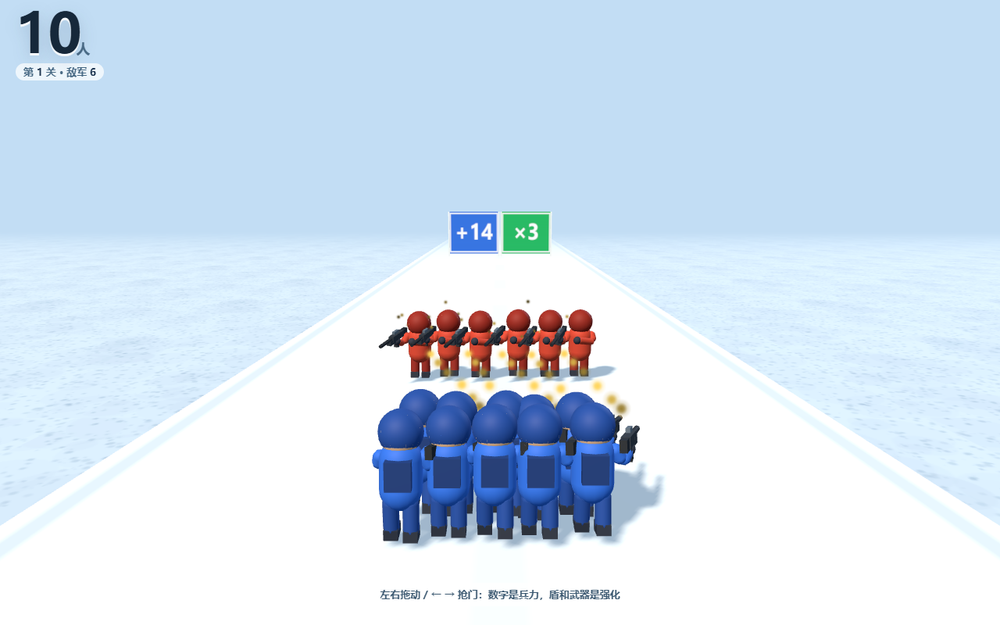
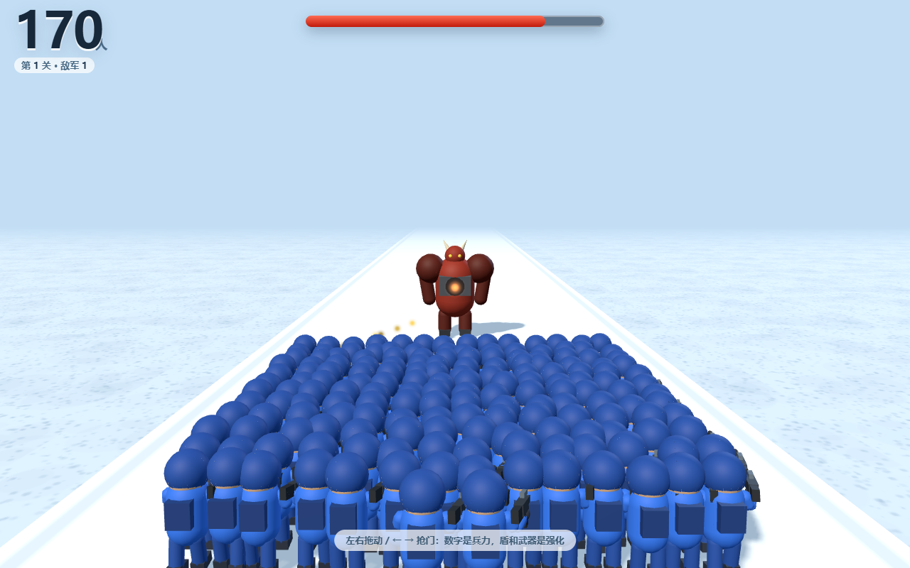
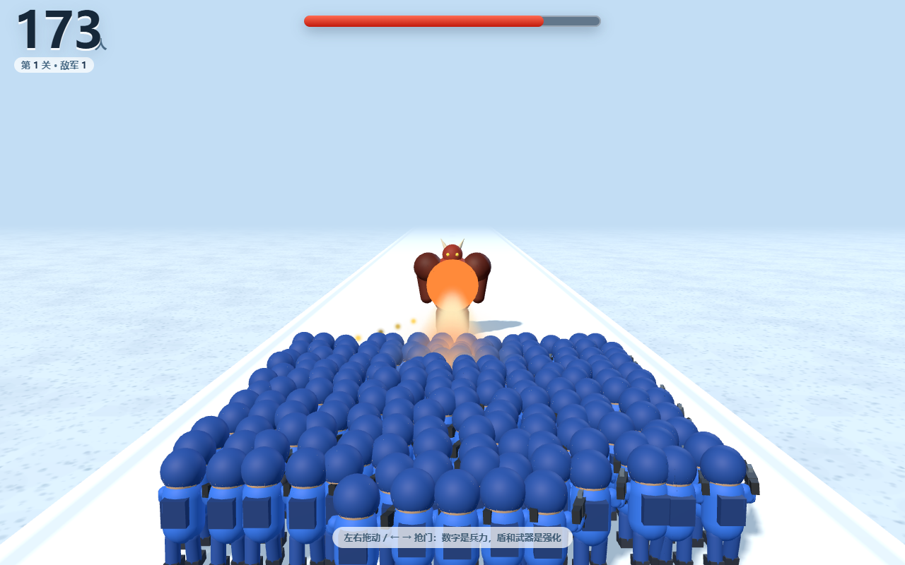

# 人群指挥官 · Gate Runner

一个 3D「数值门跑酷」的原型。

举枪的小人一路往前冲，左右两扇门上写着 `+6` / `×2`，撞哪边，队伍就变成多少人；撞完迎面撞上兵线，自动开火。过关之后进入整备，用兵力换强化。

纯前端，零构建，双击即玩。

> **这是主版本（3D 网页版）。**
> 另有一个抖音像塑移植版：[gate-runner-effect](https://github.com/dsjsunu/gate-runner-effect)。
> 受像塑引擎限制（没有 GPU 实例化，人数上限只有 24），那个版本的表现和完成度都不如这里，仅作特效侧留档。



---

## 跑起来

直接双击 `web/index.html`，不需要服务器、不需要 npm install。

唯一的外部依赖是 `web/three.min.js`（Three.js r150，已随仓库附带）。

**操作**

- 按住屏幕左右拖动，或者 `←` `→` / `A` `D`

---

## 玩法

### 局内：只有数值门

四个数值门，撞到哪边按哪边结算：

| 门 | 效果 |
|---|---|
| `+N` | 加人 |
| `×N` | 翻倍 |
| `-N` | 扣人（走错就掉血） |
| `÷N` | 减半 |

门的判定看你在门的瞬间站在中线哪一侧。

### 关卡之间：整备

每过一关，**初始兵力 +8**（第 1 关 5 人，第 2 关 13 人，第 3 关 21 人）。

开打前可以三选一，代价直接从初始兵力里扣：

| 选项 | 代价 | 效果 |
|---|---|---|
| 护盾 | -30% | 剩下每人 +14 护盾，先扣盾再死人 |
| 远程枪 | -50% | 射程 26 米，敌人刚出现就开火 |
| 火箭筒 | -75%（需 12 人解锁） | 一发同时打 3 个，单兵伤害近 3 倍 |
| 不换 | 0 | 人全留着，用普通步枪 |


### 兵种

| | 血量 | 攻击方式 |
|---|---|---|
| 小兵 | 16 | 贴脸持续射击 |
| 精英 | 74 | 每 2.2 秒抛一发榴弹，落地爆炸 |
| 首领 | 4200 | 胸口核心蓄力 0.9 秒，射出激光 |

首领的激光按**当前兵力的 9%** 结算，所以人再多也会被咬掉一块。





---

## 技术说明

### 群体渲染：300 人 8 个 draw call

小兵不是一人一个模型 —— 那样 300 个单位光 draw call 就崩了。

做法是把整只士兵（头、头盔、躯干、背包、四肢、枪）**合并成一个带顶点色的 `BufferGeometry`**，再按「身体 / 腿」拆成两个 `InstancedMesh`。腿单独拆出来是为了能摆动。

一个阵营 = 2 个 draw call，场上同时有蓝方 + 小兵 + 精英 + 首领 = 8 个。

### 零素材

除了 Three.js 本身，仓库里没有任何模型、贴图、音频文件：

- 士兵、首领、枪、榴弹：全部用基础几何体（球、胶囊、方块、圆柱）在代码里拼
- 地面、路面贴图：`<canvas>` 现画
- 音效：WebAudio 现场合成（白噪声脉冲做枪声、正弦扫频做爆炸）

### 子弹

不是画线，是一串发光贴片沿弹道飞行 + 拖尾 + 命中火花。贴片永远面向镜头，任何角度都不会露出硬边。

### 打击逻辑

前排每个士兵挑最近的一个敌人开火，伤害摊到整条兵线上 —— 而不是所有人集火一个人。这样整排是一起掉血、一起倒下，而不是一个一个消失。

---

## 调试参数

地址栏后面加 hash 可以跳到任意时刻：

```
web/index.html#t=35&freeze=1      # 预演 35 秒后定格
web/index.html#lv=3                # 直接从第 3 关开始
web/index.html#pick=0              # 自动选整备（0盾 1远 2炮 3不换）
web/index.html#x=-3                # 初始站位左移（测某扇门）
```

可以组合：`#lv=1&pick=3&t=33` 直接看首领战。

---

## 目录

```
web/
  index.html      入口 + HUD + 整备界面
  three.min.js    Three.js r150
  js/
    units.js      程序化角色几何 + 实例化群体 + 粒子
    game.js       游戏逻辑、关卡、战斗、界面
docs/             截图
```

---

## 还没做的

- 小兵没有骨骼动画，只有腿部摆动和身体起伏
- 音效是合成的，偏"塑料感"
- 微信小游戏 / 抖音小游戏的移植还没做 —— 逻辑层不依赖 DOM，但 HUD 是 DOM 实现的，需要改成 canvas 绘制
